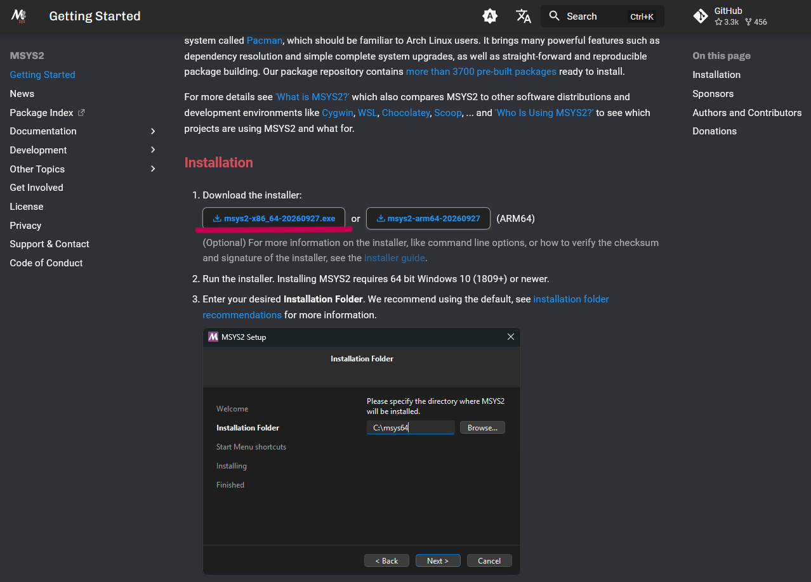
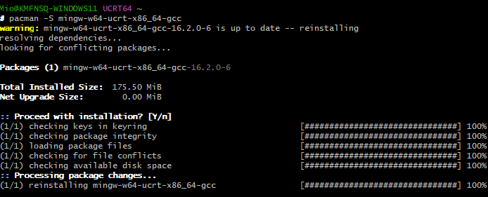
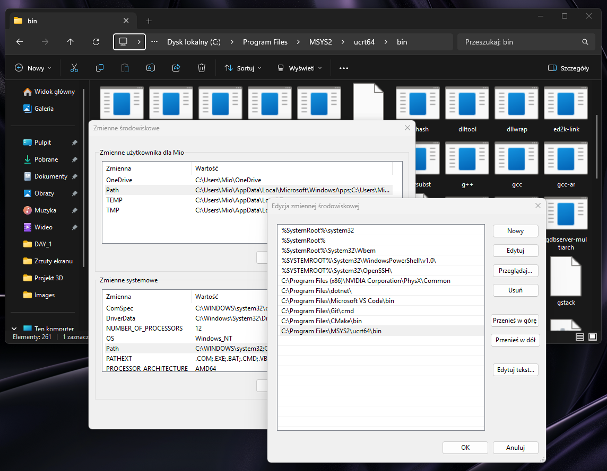
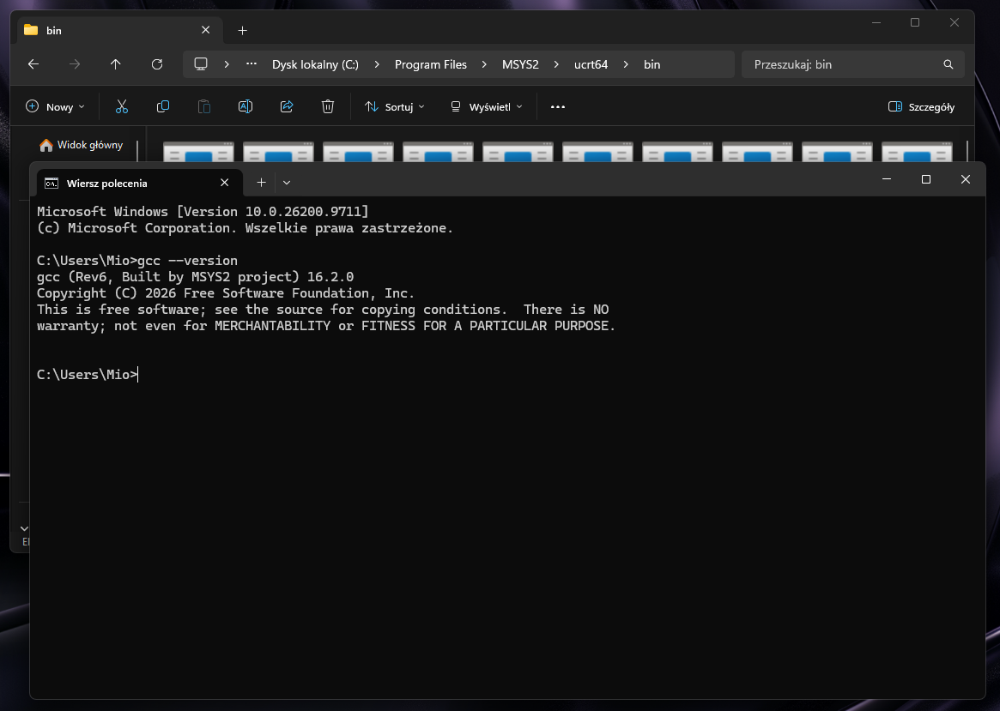
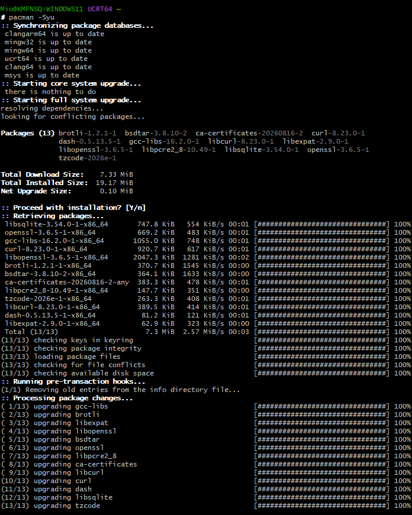
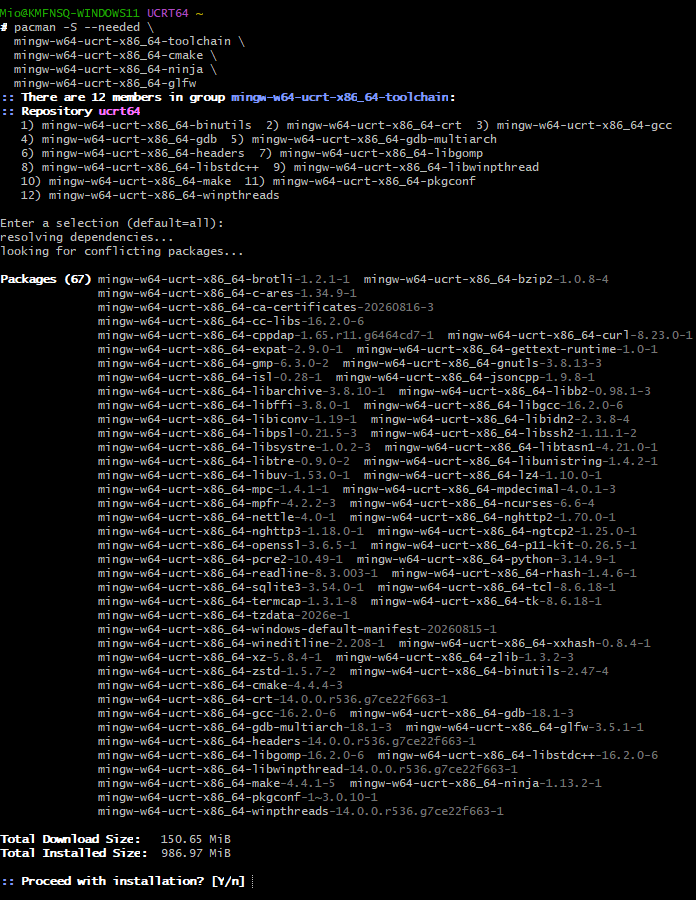
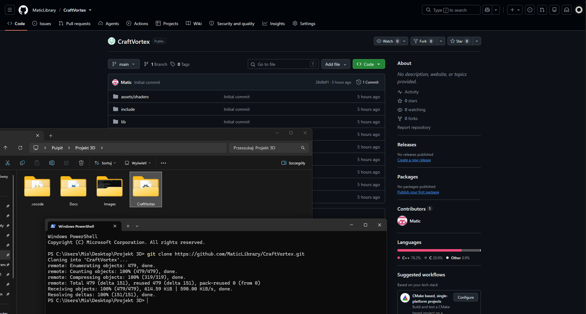
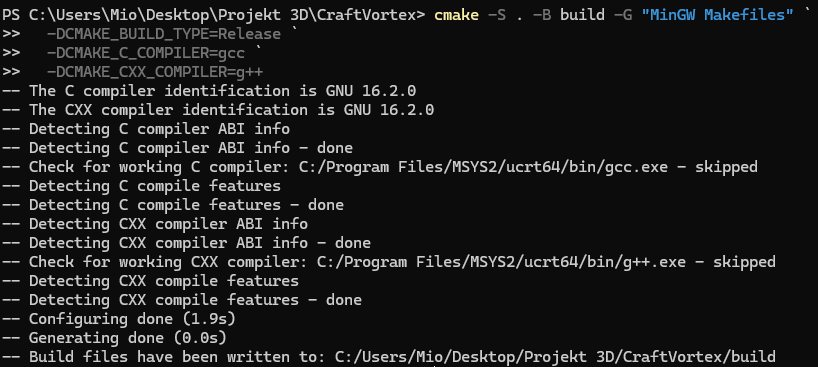
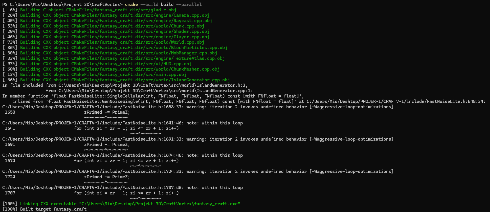
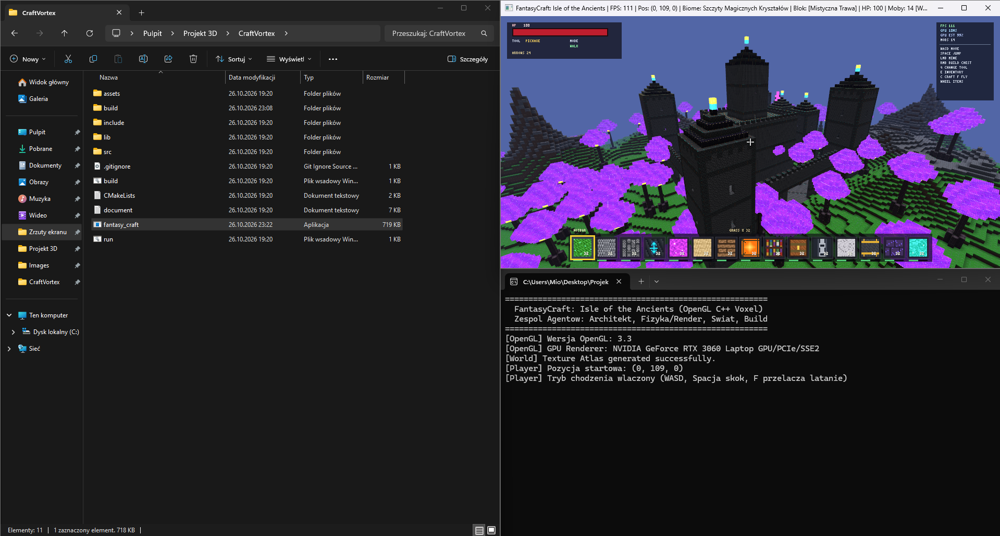

## ZALEŻNOŚCI
- [Git](https://git-scm.com/)
- [CMake](https://cmake.org/)
- [MinGW (MSYS2)](https://www.msys2.org/)

## INSTALACJA MSYS2
#### Pobierz [instalator](https://www.msys2.org/) z oficjalnego źródła

***[!]** pamiętaj o pobraniu wersji na architekture **AMD64 (x86_64)** zamiast na ARM64*
*instrukcje odnośnie instalacji znajdziesz na oficjalnym źródle*
#### Zainstaluj pakiet MinGW w środowisku MSYS2
***[!]** pamiętaj by urochomić środowisko jako administrator*
```bash
$ pacman -S mingw-w64-ucrt-x86_64-gcc
```

#### Dodaj lokalizacje plików binarnych MinGW do zmiennej środowiskowej PATH

#### Teraz MinGW powinien działać z poziomu Windows Terminal



## KONFIGURACJA ŚRODOWISKA
#### W terminalu [**MSYS2 UCRT64**](https://www.msys2.org/docs/environments/) zsynchronizuj i zaaktualizuj środowisko
``` bash
$ pacman -Syu
```

#### Następnie zainstaluj zależności dla środowiska MinGW
``` bash
$ pacman -S --needed \
   mingw-w64-ucrt-x86_64-toolchain \
   mingw-w64-ucrt-x86_64-cmake \
   mingw-w64-ucrt-x86_64-ninja \
   mingw-w64-ucrt-x86_64-glfw
```

*podczas instalacji możesz dostrzec ostszerzenia o brakujących opcjonalnych zależnościach i niepoprawnie wykonywanych komendach, zignoruj je*


## KONFIGURACJA I BUDOWA PROJEKTU
#### Sklonuj repozytorium projektu z GitHuba
``` bash
$ git clone https://github.com/MaticLibrary/CraftVortex.git
```

#### Wejdź do katalogu głównego projektu i skonfiguruj pliki Make
```bash
$ cmake -S . -B build -G "MinGW Makefiles" `
   -DCMAKE_BUILD_TYPE=Release `
   -DCMAKE_C_COMPILER=gcc `
   -DCMAKE_CXX_COMPILER=g++
```

#### Zbuduj projekt
``` bash
$ cmake --build build --parallel
```


## URUCHOM PROJEKT
