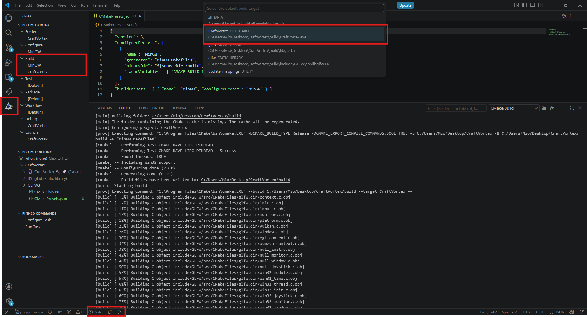

# WYMAGANE ZALEŻNOŚCI
| Narzędzie | Zastosowanie |
| --- | --- |
| [Git](https://git-scm.com/) | System kontroli wersji |
| [CMake](https://cmake.org/) | Konfiguracja projektu |
| [MinGW MSYS2 (GCC, G++)](https://www.mingw-w64.org/) | Kompilatory OpenSource |
| [Microsoft Visual C++ (MSVCP)](https://learn.microsoft.com/pl-pl/cpp/windows/latest-supported-vc-redist?view=msvc-170) | Kompilatory Microsoft |
| [GLFW (OpenGL Framework)](https://www.glfw.org/) | Obsługa kontekstu |
| [GLAD (OpenGL Loader Generator)](https://glad.dav1d.de/) | Wczytywanie funkcji OpenGL |
| [GLM (OpenGL Mathematics)](https://github.com/g-truc/glm) | Biblioteka matematyczna |
| [Fast Noise Lite](https://github.com/Auburn/FastNoiseLite) | Generacja szumu |

# BUDOWA PROJEKTU (TERMINAL)
## Windows (MinGW)
Pobierz i zainstaluj [CMake](https://cmake.org/download/) i [MinGW](https://www.msys2.org/). Dodaj `C:\MinGW\bin` do `PATH`.
Następnie użyj podane poniżej komendy:
```powershell
cmake -S . -B build -G "MinGW Makefiles" -DCMAKE_BUILD_TYPE=Release; if ($?) { cmake --build build -j }
```

## Linux (GCC)
Upewnij się że twoja dystrybucja posiada potrzebne biblioteki
### Fedora
```bash
$ sudo dnf install gcc gcc-c++ cmake make pkgconf-pkg-config libX11-devel libXrandr-devel libXinerama-devel libXcursor-devel libXi-devel wayland-devel wayland-protocols-devel libxkbcommon-devel mesa-libGL-devel libstdc++-static
```
### Debian
```bash
$ sudo apt install build-essential cmake pkg-config xorg-dev libwayland-dev wayland-protocols libxkbcommon-dev libgl1-mesa-dev
```
### Arch
```bash
$ sudo pacman -S --needed base-devel cmake pkgconf libx11 libxrandr libxinerama libxcursor libxi wayland wayland-protocols libxkbcommon mesa
```

Następnie użyj podane poniżej komendy:
```bash
cmake -S . -B build -DCMAKE_BUILD_TYPE=Release && cmake --build build --config Release -j
```

# BUDOWA PROJEKTU (IDE)
## Visual Studio Code (MinGW)
Pobierz [Visual Studio Code](https://code.visualstudio.com/download), następnie wgraj rozszerzenia [C/C++](https://marketplace.visualstudio.com/items?itemName=ms-vscode.cpptools) i [CMake](https://marketplace.visualstudio.com/items?itemName=ms-vscode.cmake-tools). 
Zrestartuj IDE i wejdź w zakładkę CMake, następnie użyj skrótu `Ctrl`+`Shift`+`P`, wpisz `CMake: Set Build Target` i wybierz `CraftVortex Executable`. Od teraz możesz swobodnie budować i uruchamiać projekt w lewym dolnym rogu edytora.

